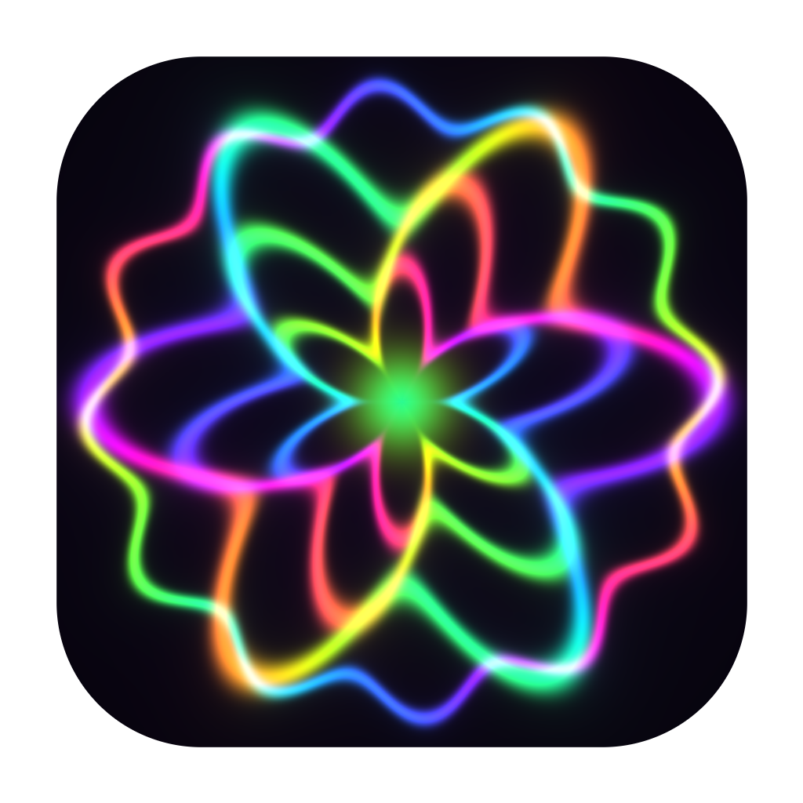
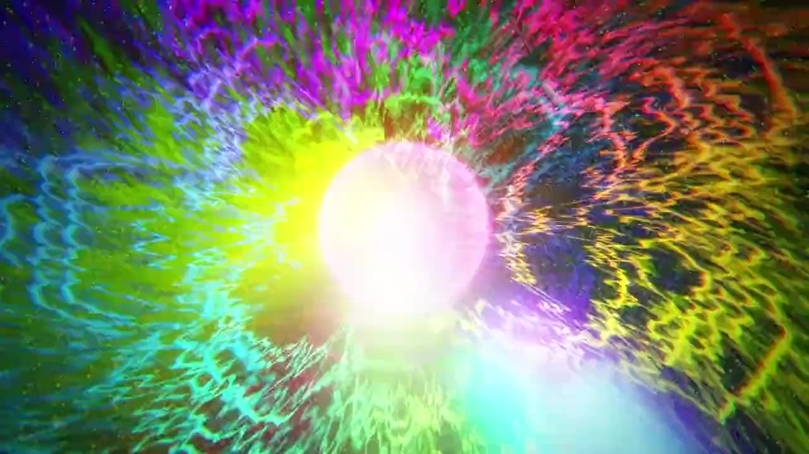
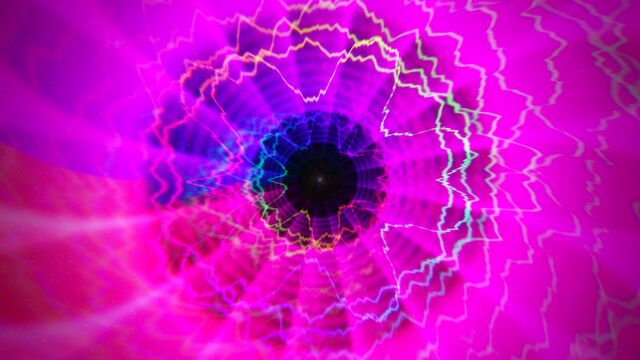
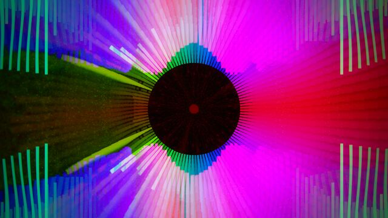
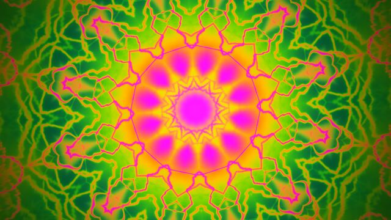
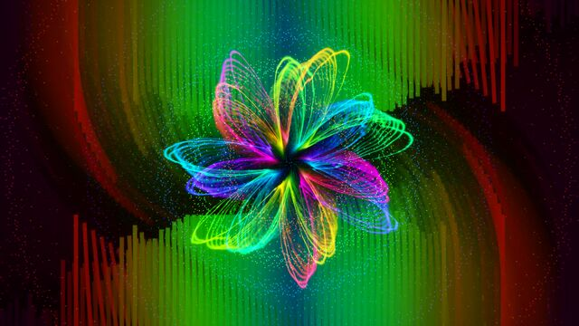
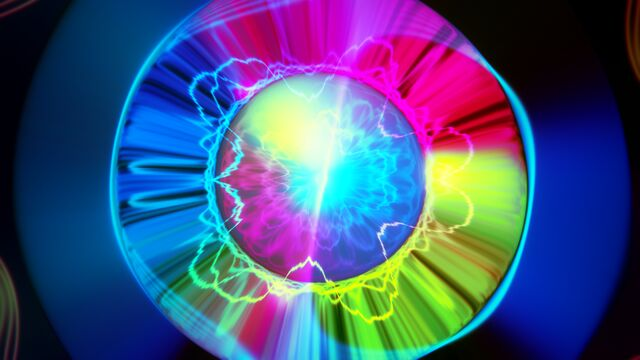
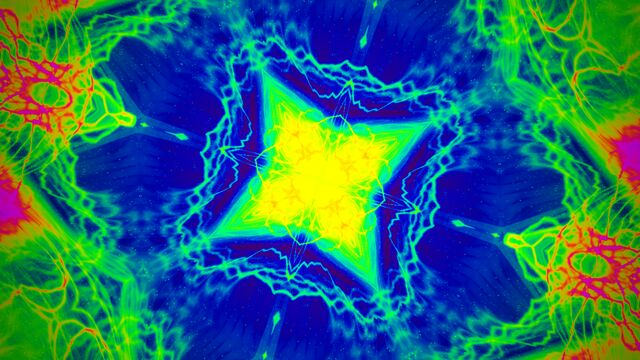

<p align="center">
  
</p>

<h1 align="center">Prismatica</h1>

<p align="center">
  A psychedelic music visualizer in the spirit of the old iTunes and Windows Media Player visualizers, with a lot more going on.<br>
  Ten scenes that breathe with the bass, flash on the beat and drift on the melody.
</p>

<p align="center">
  <a href="https://github.com/lunacrescens/prismatica/releases/latest"><b>Download</b></a> ·
  <a href="https://lunacrescens.github.io/prismatica/play/"><b>Try it in your browser</b></a> ·
  <a href="https://lunacrescens.github.io/prismatica/">Website</a>
</p>

<p align="center">
  
</p>

## Download

| | Windows | macOS |
|---|---|---|
| **Prismatica** (recommended): every feature, including lyrics and settings | [Windows x64](https://github.com/lunacrescens/prismatica/releases/latest/download/Prismatica-Electron-Windows-x64.zip) | [Apple Silicon](https://github.com/lunacrescens/prismatica/releases/latest/download/Prismatica-Electron-Mac-AppleSilicon-arm64.zip) · [Intel](https://github.com/lunacrescens/prismatica/releases/latest/download/Prismatica-Electron-Mac-Intel-x64.zip) |
| **Prismatica Native**: tiny, and runs on older Macs whose graphics Chromium no longer supports | [Windows x64](https://github.com/lunacrescens/prismatica/releases/latest/download/Prismatica-Native-Windows-x64.zip) | [Universal](https://github.com/lunacrescens/prismatica/releases/latest/download/Prismatica-Native-Mac-Universal.zip) |
| **Ripple Tank screensaver**: a calm, silent version of one scene | [.scr](https://github.com/lunacrescens/prismatica/releases/latest/download/Prismatica-RippleTank-Screensaver-Windows.zip) | [.saver](https://github.com/lunacrescens/prismatica/releases/latest/download/Prismatica-RippleTank-Screensaver-Mac.zip) |
| **Browser**: no install | [Open it](https://lunacrescens.github.io/prismatica/play/) | [Open it](https://lunacrescens.github.io/prismatica/play/) |

The apps aren't signed with a paid certificate yet. **Windows:** More info → Run anyway. **macOS:** System Settings → Privacy & Security → Open Anyway (or `xattr -cr /Applications/Prismatica.app`).

## Scenes

| | | | | |
|:-:|:-:|:-:|:-:|:-:|
| <br>Event Horizon | <br>Mandala Engine | <br>Liquid Aurora | <br>Neon Tunnel | <br>Spectrum Bloom |
| <br>Kaleido Fever | <br>Phyllotaxis | <br>Ripple Tank | <br>Hyperflower | <br>Meltdown |

Every scene is a stack of layers (oscilloscopes, spectrum rings, rose curves, particles, tunnels, plasma) drawn into a feedback buffer that warps, zooms and recolours the previous frame. Prismatica cross-fades to the next scene on a beat, or you can lock the one you like.

## Features

- **Listen to anything**: music files (MP3, FLAC, WAV, OGG, M4A; drop files or whole folders on the window), whatever your computer is playing, a microphone or line-in, or the built-in demo track.
- **Reacts to the music**: bass, mids and highs each drive their own layers; beat detection fires shockwaves and scene changes.
- **Synced lyrics**: line-by-line lyrics from a `.lrc` file next to the song, the file's own tags, or [LRCLIB](https://lrclib.net). Search by hand when a song isn't matched; nudge timing with `[` and `]`.
- **Out of the way**: controls and cursor fade out after a few seconds; double-click for fullscreen; a small settings menu (`,`) remembers your choices.

| Key | Action | Key | Action |
|---|---|---|---|
| `Space` | Play / pause | `←` `→` | Previous / next scene |
| `1`–`0` | Jump to a scene | `R` | Random scene |
| `L` | Lock scene / auto-cycle | `N` / `P` | Next / previous track |
| `O` | Open files | `F` | Fullscreen |
| `Y` | Lyrics on / off | `S` | Search lyrics |
| `,` | Settings | `?` | All keys |

Lyrics and the settings menu are in the Electron and browser versions; the native version has the scenes, audio sources and keys.

## What's in this repository

```
electron/   The main app: Electron + WebGL 2. Also the source of the browser version.
native/     The native app (C++17, OpenGL 3.3, CMake) and the Ripple Tank screensaver.
website/    The website (plain static files), published to GitHub Pages.
.github/    Workflows: build every download on a version tag, publish the website on push.
```

Both apps share the same scenes and shaders: `electron/shaders.js` and `native/src/shaders.h` hold the same GLSL.

## Building

### Electron app

Needs [Node.js](https://nodejs.org/) 20 or newer.

```sh
cd electron
npm install
npm start             # run it
npm run dist:win      # dist/Prismatica-Electron-Windows-x64.zip
npm run dist:mac      # dist/Prismatica-Electron-Mac-*.zip (build on a Mac so the apps get signed)
npm run html          # rebuild the browser version into website/play/index.html (needs Python 3)
```

### Native app and screensaver

Needs [CMake](https://cmake.org/) 3.21+ and a C++17 compiler: Visual Studio 2022 on Windows, Xcode command-line tools on macOS, GCC or Clang on Linux. CMake downloads GLFW, Dear ImGui, miniaudio and portable-file-dialogs itself.

```sh
cd native
cmake -B build -DCMAKE_BUILD_TYPE=Release
cmake --build build --config Release
```

- **macOS universal build** (Intel + Apple Silicon): add `-DCMAKE_OSX_ARCHITECTURES="arm64;x86_64"`.
- **Linux** needs the X11 and OpenGL headers, e.g. `sudo apt install libx11-dev libxrandr-dev libxinerama-dev libxcursor-dev libxi-dev libgl1-mesa-dev`.
- **Skip the screensaver** with `-DPRISMATICA_BUILD_SAVER=OFF`.

Output: `Prismatica.exe` and `Prismatica Ripple Tank.scr` (Windows), `Prismatica.app` and two `.saver` bundles (macOS), `prismatica` (Linux).

## Releasing

Push a version tag and GitHub Actions builds everything and attaches it to a new release:

```sh
git tag v1.0.1
git push origin v1.0.1
```

The files keep the same names every release, so the website's download buttons (which point at `releases/latest/download/<file>`) always get the newest version. To build without releasing, run the **Release** workflow by hand from the Actions tab and download the files from the run.

The website deploys on every push to `main` that touches `website/` or `electron/`. One-time setup: **Settings → Pages → Source: GitHub Actions**.

## License

[MIT](LICENSE). Prismatica uses several open-source projects; see [THIRD_PARTY_NOTICES.md](THIRD_PARTY_NOTICES.md).
